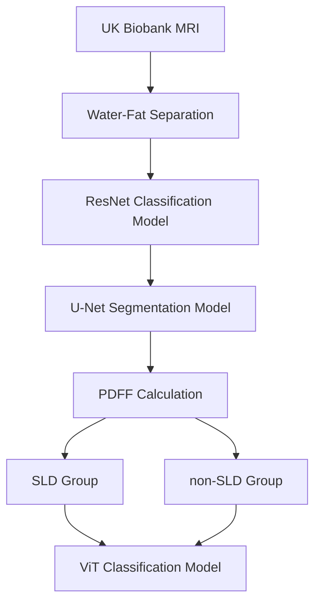

PNPLA3 SNP prediction
===
Here we show the code used in the study "Deep learning on liver MRI predicts PNPLA3 I148M in steatotic liver disease". Since the database used is a third-party database UK Biobank, no data can be provided here. The toolbox used for water fat separation is not open source, so it cannot be provided here either.

## Table of Contents

- [Required envionment](#Required-envionment)
- [Get started!](#Get-started!)
- [User flows](#User-flows)

## Required envionment

The code was successfully tested on Anaconda virtuall envionment with python==3.10.13, Pytorch==2.0.0 with CUDA==11.8 (https://pytorch.org/get-started/previous-versions/)


## Get started! 
1. Create a virtuall environment in the anaconda prompt for using the code, please change the env_name for your envionment.
```gherkin=
conda create --name {env_name} python=3.10.13
```
<br>

2. Install pytorch according to your GPU and CUDA version. Here is an example:
```gherkin=
conda install pytorch==2.0.0 torchvision==0.15.0 torchaudio==2.0.0 pytorch-cuda=11.8 -c pytorch -c nvidia
```
<br>

3. Install nessesary packages under the requirement file folder
```gherkin=
pip install -r requirement.txt
```

## User flows


## How to use
This Pipeline is designed for UKB Liver MRI image. For other dataset, you might need to change naming strategy in the source code. All patient folder are **renamed to numbers counting from 1**, the mapping from old name to new name and EID are saved in a .csv file with column name "Old_name", "ID", "eid", respectively.

*The code of the water fat separation toolbox is not open source, the code here only provides the code after the water fat separation. To get the toolbox, plesea contact the owner.*  

After performing water-fat separation, the resulting data is stored in .mat files, with each file corresponding to a patient. Inside each file, four reconstructed images are saved: water-signal-only ('water'), fat-signal-only ('fat'), fat fraction map ('ff'), and r2* map ('r2star'). These four images are stored within a structure called "outputImages". Fat fraction map might have different scale, you could also calculate it yourself via fat/(fat+water).

```
    XXXX.mat
        └───outputImages
            ├───water
            ├───fat
            ├───ff
            └───r2star
```

Please put your dataset after WFS in this folder: dataset/fullcohort_1_wfs

1. Dataset quality control
To remove unqualified data from our dataset, we first train a ResNet model to help us for the identification. To use the ResNet, you need to visualize reconstructed images and select some as train/validation data. You could find detailed introduction in ResNet folder. 
2. Liver segmentation
You need some training data for the U-Net model trainng (manully or use some tools). Liver segmentations are saved in .mat file. You could find detailed introduction of this step in U-Net folder
3. SNP classification
Use ViT to train your classification model! After liver segmentation we extract required liver mask and images that used for training our classification model. You could find detailed introduction in Vision-Transformer folder

