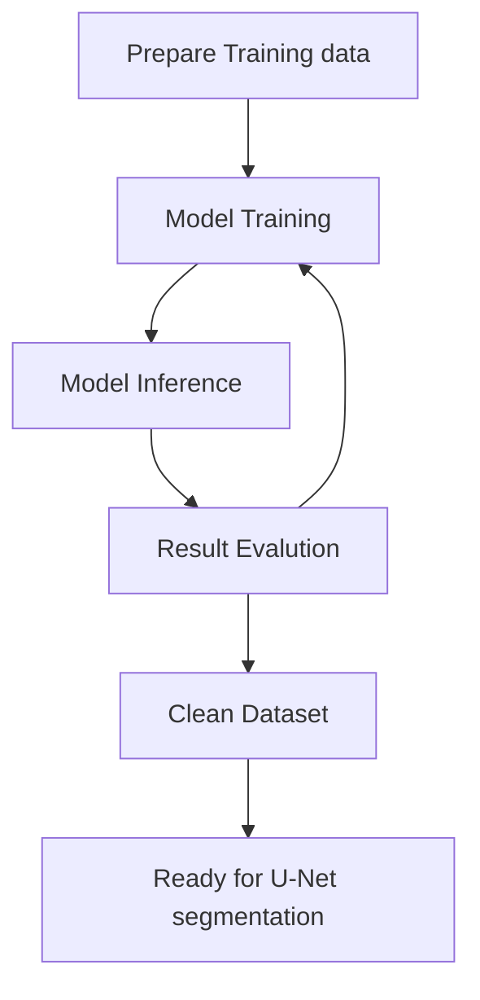

ResNet-based Quality Control 
===
This pipeline helps us to clean our dataset. As there are artifects in the MRI, which can not be used in subsequent tasks, we train a ResNet model to help us classify unqualified images. The main idea is to lable qualified images as 0 and unqualified images as 1. Use annotated training data to train a ResNet model, refine the model and finally inference the whole dataset. The last step is remove all images which classified as label 1.

## Table of Contents

- [Folder Structure](#Folder-Structure)
- [Get started!](#Get-started!)
- [User flows](#User-flows)

## Folder Structure

```
    📁Resnet
        ├───resnet_config.yaml
        ├───resnet_datasets.py
        ├───resnet_inference.py
        ├───resnet_to_unet.py
        ├───resnet_train.py
        ├───resnet_utils.py
        └───📁training_dataset
            ├───📁train
            |   ├───1.mat
            |   └───2.mat
            └───📁val
                ├───3.mat
                └───4.mat
```
#### Training data
* **training_dataset** folder store your training data. 
#### Script
* **resnet_config.yaml** is configuration file, you could change parameter here to adjust the model to your project
* **resnet_train.py** is main train script, run this script in the terminal to train the model once you have setup your configuration file
* **resnet_inference.py** is the script when you have your final model, run this script to inference the whole dataset
* **resnet_to_unet.py** Once you finish your inference, run this script to remove the unqualified samples and convert the file into **.nifti** format for the next U-Net segmentation step.
* **resnet_datasets.py** and **resnet_utils.py** are scripts with helper functions.

## Get started! 
This is a multi-round semi-automated quality control pipeline, manual evaluation for each round is required. 
1. **Prepare your training data**. We use normal fat fraction image as our positive sample, label as 0. Due to most unqualified images have water-fat swap artifect, once this happens, the fat and water signal will swaped, so we use water fraction map (1 - fat fraction) as our first round negative sample, label as 1.

    ```
    - Split 50-100 qualified image (xxx.mat) into train/val set
    - Put them into training_dataset folder
    ```
<br>

2. **Model Training**
    ```
    - setup your configuration file resnet.config.py or use default settings
    - run resnet_train.py
    ```
<br>

3. **Model Inference**
    ```
    - run resnet_inference.py
    - output folder automatically created
        
        📁Resnet
        ├───...
        └───📁output
            ├───📁artifect_samples
            ├───📁correct_samples
            ├───📁inference_artifect
            ├───📁inference_correct
            ├───acc_loss_plot.png
            ├───inference_results.csv
            ├───metrics.csv
            └───resnet_model.pth
    ```
    * **Inference folder** save the predicted artifect/correct samples. 
    * **artifect/correct_samples folder** save true artifect/correct samples after manual evaluation (step 4)
    
<br>

4. **Result Evaluation (semi-auto)**
    Step 1: 
    Check predicted unqualified samples in **Resnet/output/inference_artifact** folder
    ```
    - Delete all qualified image (wrong predicted)
    ```
    
    Step 2:
    Check predicted qualified samples in **Resnet/output/inference_correct** folder
    ```
    - Delete all unqualified image from each bin(wrong predicted)
    ```
    （⚠️ *for the first round, there might be few artifect images in the inference_artifect folder. In this case, please check subfolders with low probabilities interval in the inference_correct folder, cut artifect images from there to inferenceartifect folder*）

<br>

5. **Repeat step 2-4**
    ```
    - Retrain the model with more data, which we get from step 4
    - Stop till there are no new correct predicted artifect images 
    ```
<br>

6. **Prepare the data for next segmentation pipeline (U-Net)**
    Script resnet_to_unet.py will automatically remove the artifect images from your dataset and convert the file format to nifti, which will be used in the segmentation folder.
    ```
    - run resnet_to_unet.py
    - Stop till there are no new correct predicted artifect images 
    ```
    
    

## User flows


