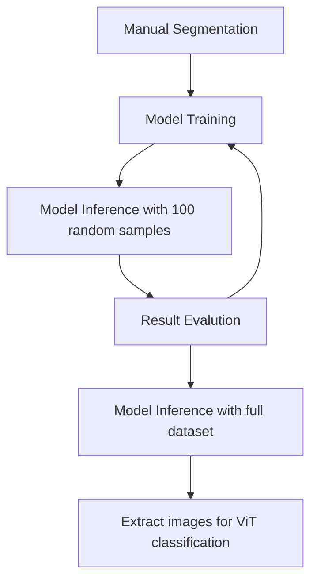

UNet-based Segmentation
===
This pipeline helps us to segment region of interest (ROI). After first quality control pipeline, we removed unqualified images from our dataset and convert the format from .mat to .nifti. This pipeline need ground truth as training data, which could be done by user themself using open-source segmentation software [ITK-SNAP](https://www.itksnap.org/pmwiki/pmwiki.php).

## Table of Contents

- [Folder Structure](#Folder-Structure)
- [Get started!](#Get-started!)
- [User flows](#User-flows)

## Folder Structure

```
    📁U-Net
        ├───unet_config.yaml
        ├───unet_datasets.py
        ├───unet_inference.py
        ├───unet_to_vit.py
        ├───unet_train.py
        ├───unet_utils.py
        └───📁training_dataset
            ├───📁train
            |   ├───📁image
            |   |    └───1.nii.gz
            |   └───📁mask
            |        └───1.nii.gz
            └───📁val
                ├───📁image
                └───📁mask
```
#### Training data
* **training_dataset** folder store your training data. 
#### Script
* **unet_config.yaml** is configuration file, you could change parameter here to adjust the model to your project
* **unet_train.py** is main train script, run this script in the terminal to train the model once you have setup your configuration file
* **unet_inference.py** is the script when you have your final model, run this script to inference the whole dataset
* **unet_to_vit.py** Once you finish your inference, run this script to extract images for the next ViT classification step.
* **unet_datasets.py** and **unet_utils.py** are scripts with helper functions.

## Get started! 
This is a multi-round semi-automated segmentation pipeline, manual evaluation for each round is required. 

1. **Prepare your training data**. Use software (see suggestion above) to segment your ROI as gournd truth training data, save the mask as .nii.gz file.

    ```
    - Segment 100 (adjust according to your dataset and ROI) masks
    - Put them into training_dataset folder
    ```
<br>

2. **Model Training**
    ```
    - setup your configuration file unet.config.py or use default settings
    - run unet_train.py
    ```
<br>

3. **Model Inference with 100 random samples**
    ```
    - In the unet_config.yaml, set evaluation/sample_numer to 100
    - In the unet_config.yaml, set your original UKB dicom path
    - run unet_inference.py
    
    - output folder automatically created
        
        📁U-Net
        ├───...
        └───📁output
            ├───📁inference
            ├───📁inference_plot
            ├───pdff_values_sigmaclip.csv  
            └───unet_model.pth
    ```
    * **Inference folder** save the predicted masks. 
    * **Inference_plot folder** plot the predicted masks with images for evaluation
    
<br>

4. **Result Evaluation (manual)**

    
    ```
    - Check and correct wrong predicted masks in the segmentation software
    - Put new corrected masks and corresponding image .nii.gz file into training_dataset folder
    ```
    


<br>

5. **Repeat step 2-4**
    ```
    - Retrain the model with more data, which we get from step 4
    - Stop till we are happy with the masks 
    ```
<br>

6. **Model Inference with full dataset**
    ```
    - In the unet_config.yaml, set evaluation/sample_numer to "full_cohort"
    - run unet_inference.py
    ```

6. **Prepare the data for next classification pipeline (ViT)**
    Script unet_to_vit.py will automatically extract images from your dataset.
    ```
    - run resnet_to_unet.py
    ```
    
    

## User flows


