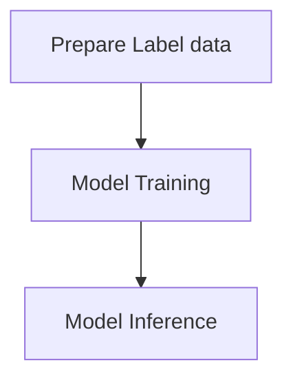

ViT-based Image Classification
===
This is a binary image classification pipeline using data derived from last two steps. The dataset are saved in training_dataset folder. The image here using for training and inference are only masked area and interpolate to 224x224 according to the bounding box of ROI, detail explanation please check our paper.

## Table of Contents

- [Folder Structure](#Folder-Structure)
- [Get started!](#Get-started!)
- [User flows](#User-flows)

## Folder Structure

```
    📁Vision-Transformer
        ├───vit_config.yaml
        ├───vit_datasets.py
        ├───vit_inference.py
        ├───vit_train.py
        ├───vit_utils.py
        └───📁training_dataset
            ├───📁SLD_cohort
            |   ├───1.npy
            |   └───2.npy
            └───📁nonSLD_cohort
                ├───3.npy
                └───4.npy
```
#### Training data
* **training_dataset** folder store your training data. Full cohort are splitted into SLD and non-SLD cohort. The data are automatically created after U-Net inference with full cohort
#### Script
* **vit_config.yaml** is configuration file, you could change parameter here to adjust the model to your project
* **vit_train.py** is main train script, run this script in the terminal to train the model once you have setup your configuration file
* **vit_inference.py** is the script when you have your final model, run this script to inference the whole dataset
* **vit_datasets.py** and **vit_utils.py** are scripts with helper functions.

## Get started! 
 
1. **Prepare your label data**. We merge our output **pdff_values_sigmaclip.csv** file from U-Net inference label and renaming mapping file together. Make sure you have your label (for example, rs738409_G), rename mapping .csv file (ID and eid, details please see main readme file), features for subgroups (BMI, SEX, AGE etc.), merge them with "eid". The name of .csv file should remain the same under the dataset folder in the main REPO: **dataset/pdff_values_sigmaclip.csv**

    **For SNP label**
    Non-carriers are labelled as 0
    Heterozygous carriers are labelled as 1
    Homozygous carriers are labelled as 2
    
    Pipeline will automatically stratified randomly split data into train/val/test set, remove heterozygous carrier, doing Cross-Validation. Details please check our paper.

    ```
    - Prepapre your label file pdff_values_sigmaclip.csv
    ```
<br>

2. **Model Training**
    Inference will automatically executed directly after training. 
    ```
    - setup your configuration file resnet.config.py or use default settings
    - run vit_train.py
    ```
<br>

3. **Model Inference**
    Inference the dataset with existed model. 
    ```
    - run resnet_inference.py
    - output folder automatically created
        
        📁Resnet
        ├───...
        └───📁output
            ├───best_model_fold1.pth
            ├───best_model_fold2.pth
            ├───best_model_fold3.pth
            ├───best_model_fold4.pth
            ├───best_model_fold5.pth
            ├───test_list.csv
            ├───Test_AUR_ROC.png
            ├───Test_PR.png
            ├───test_CM.png
            ├───train_fold1-5.png
            ├───val_fold1-5.png
            └───📁attention_map
                ├───📁fold1-5
                └───📁final_attention_maps
                    ├───📁FN
                    ├───📁FP
                    ├───📁TN
                    └───📁TP
                        └───1.png
    ```
    * Best model, training/validation confusion matrix and test attention maps/AUC curve/PR curve/confusion matrix are saved in this folder 
    * Attention maps from each folder are finally merged together and saved in final_attenton+maps folder with False Negative(FN), False Positive(FP), True Negative(TN) and True Possitive(TP) subfolders. 
    
<br>

4. **Subgroup Analysis**
    See vit_config.yaml
    ```
    - choose your subgroups in data/cohort 
    ```
    
   
    
    

## User flows


